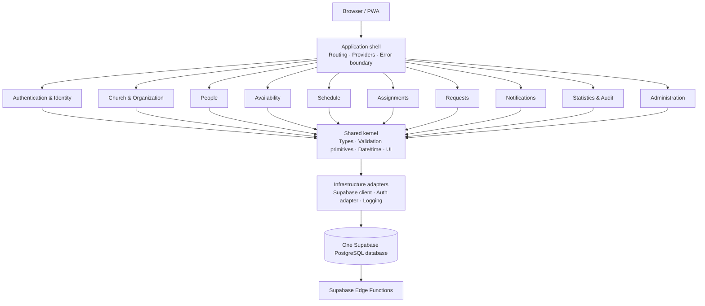
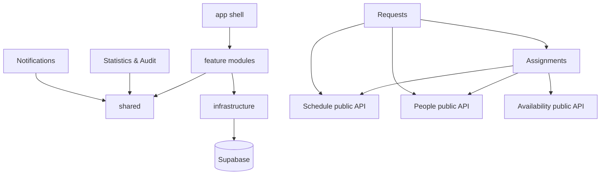

# GMS Sound Scheduling System V2 — Architecture & Refactoring Blueprint

**Document status:** Proposed target architecture  
**Baseline reviewed:** `GMS-Sound-Scheduling-System-main` archive supplied 4 November 2026  
**Implementation package:** Part 1 — Foundation and transition boundary  
**Architecture decision:** Modular monolith, single Supabase project, shared PostgreSQL database

---

## 1. Executive decision

Rebuild the application structure incrementally as a **modular monolith**. Do not split it into microservices and do not create a separate Supabase project or database for each feature.

A modular monolith means:

- one web application and one frontend deployment;
- one Supabase Auth tenant and one PostgreSQL database;
- feature modules with explicit ownership and public interfaces;
- one shared infrastructure layer for authentication, database access, authorization adapters, logging, and design primitives;
- transactional database functions for operations that change multiple related records;
- independent module tests and controlled extraction/replacement of feature implementations.

This preserves the operational simplicity of the current deployment while reducing the change blast radius.

## 2. Business rules the architecture must preserve

These are system constraints, not optional implementation preferences.

1. One central administrator manages all church locations.
2. Servant assignments are **manual**. The system may validate eligibility, show workload, and provide bulk editing, but it must not choose or allocate servants automatically.
3. Coordinators may prepare schedules and manually assign servants within their authorized scope.
4. Only administrators may publish or unpublish final schedules.
5. Servants manage their own profile information, availability, serving preferences, confirmations, and requests within the permissions granted to them.
6. A servant may not be assigned to overlapping services or to more than one church location on the same service date, unless the business owner explicitly changes that rule.
7. Published schedules are the servant-facing source of truth. Drafts are not visible as published commitments.
8. Swap and replacement approvals must revalidate current state and commit all related assignment/request changes atomically.
9. The business calendar is `Asia/Jakarta`.
10. Multi-location operation must remain supported without duplicating accounts, servants, or global administration.

### Policy requiring explicit confirmation

Migration `migrations_20261107_smart_scheduling_d1.sql` automatically changes pending assignments to `confirmed` on D-1 and sends notifications. This does **not** auto-assign servants, but it does auto-confirm a pending servant response. Retain this only if it is an approved ministry policy. Make the behavior visible in the product and test its cutoff/timezone.

## 3. What is wrong with the current structure

### 3.1 Frontend concentration

The supplied project places the application, authentication, data loading, assignment workflows, requests, notifications, reports, and many UI components in `src/App.tsx` (approximately 200 KB). `src/style.css` is also approximately 200 KB. This is an ownership and change-isolation problem, not simply a file-size problem.

### 3.2 Data and domain logic are mixed with rendering

The current app performs Supabase reads/writes and eligibility checks inside the same top-level component that renders screens. This makes it difficult to test business rules without mounting the entire app and risks different workflows implementing the same validation differently.

### 3.3 Database operations do not have a consistent transaction boundary

The bulk-assignment RPC in the latest migration uses a database transaction. In contrast, the standard `saveSchedule()` path updates/inserts a schedule, deletes its current assignments, then inserts the new rows as separate network/database operations. A failure between those operations can leave the schedule without its previous assignments.

The current edit path also changes an edited published schedule to `draft` and replaces every assignment row, resetting confirmations even when the servant-role mapping is unchanged. This may be intentional safety behavior, but it must be an explicit product rule and implemented atomically with clear user feedback.

### 3.4 Role model does not yet match the requested operating model

The current frontend `Profile` type and initial database `profiles.role` constraint support only `admin` and `servant`. They do not model a location-scoped coordinator. The target design therefore needs a carefully introduced `coordinator` role with explicit location scope; do not grant coordinator publish permissions.

### 3.5 Database schema snapshot is incomplete

The frontend references 17 tables, while the supplied `supabase/schema.sql` defines only the seven core tables. The later incremental migrations create the additional request, profile, availability, notification, push, and settings objects. The file named `schema.sql` therefore must not be treated as a complete representation of the live schema.

### 3.6 Deployment and operations are under-documented

Migration files are stored as `supabase/migrations_YYYYMMDD*.sql`, rather than the normal timestamped `supabase/migrations/` CLI directory. The README highlights one migration even though the frontend and backend reference functionality introduced in later migrations. A deployment checklist must describe the whole migration chain and verify the live migration state before applying anything.

---

## 4. Target high-level architecture



The diagram shows ownership, not separate deployments. Modules share the same runtime and database. Direct dependencies between modules must go through public contracts; notification delivery is driven by durable database events/triggers rather than direct calls into notification UI state.

## 5. Target repository structure

```text
src/
├── app/
│   ├── App.tsx                  # app composition / route outlet
│   ├── routes.tsx               # route and tab definitions
│   ├── providers/               # Auth, Query, Theme, ErrorBoundary
│   └── permissions/             # shared capability checks for presentation
│
├── modules/
│   ├── authentication/
│   │   ├── components/
│   │   ├── hooks/
│   │   ├── services/
│   │   ├── types.ts
│   │   └── index.ts             # public module API only
│   ├── organization/
│   ├── people/
│   ├── availability/
│   ├── schedule/
│   ├── assignments/
│   ├── requests/
│   ├── notifications/
│   ├── statistics/
│   └── administration/
│
├── shared/
│   ├── components/              # generic UI only
│   ├── dates/                   # business timezone/date-only utilities
│   ├── errors/
│   ├── formatters/
│   ├── types/                   # shared identifiers and primitives
│   ├── validation/              # generic validation primitives
│   └── styles/                  # tokens and global primitives
│
├── infrastructure/
│   ├── supabase/                # one browser client + generated DB types
│   ├── logging/
│   └── config/
│
└── legacy/
    └── LegacyApp.tsx            # temporary compatibility implementation

supabase/
├── migrations/                  # canonical CLI migrations after controlled baseline
├── functions/
│   ├── username-login/
│   └── dispatch-push/
├── tests/                       # SQL / integration tests
├── seed/                        # non-production seed data only
└── README.md

docs/
├── architecture/
├── engineering/
└── operations/
```

Part 1 introduces the shell, `legacy/`, shared helper ownership, infrastructure boundary, and module documentation. The business screens are intentionally not all moved in Part 1.

## 6. Module responsibilities and public contracts

| Module | Owns | Public contract / output | Must not own |
|---|---|---|---|
| Authentication | Session lifecycle, sign-in/up/reset, identity mapping | `AuthSession`, `useAuth`, `signOut` | Church/servant business rules |
| Organization | Locations, service templates, church settings | `LocationRef`, location queries | Servant assignments |
| People | Servants, member profile, active state, account linkage | `ServantRef`, `MemberProfile` | Schedule publication |
| Availability | Dated records, recurring rules, serving preferences | `AvailabilityDecision`, availability query | Assignment mutation |
| Schedule | Service instances, dates, times, draft/published lifecycle | `ScheduleRef`, schedule query | Selecting servants automatically |
| Assignments | Manual role allocation, eligibility checks, confirmation lifecycle | `AssignmentDraft`, atomic save/bulk RPC | Schedule publication permission |
| Requests | Swap/replacement submission, review, resolution | `ServingRequest`, request commands | Duplicating assignment rules |
| Notifications | Inbox, preferences, push subscriptions/delivery state | `NotificationFeed`, read/mark-read | Deciding schedule business rules |
| Statistics | Read-only reporting and aggregation | Report DTOs | Mutating schedules/assignments |
| Administration | User/role/location configuration, audit and system settings | Admin workflows | Bypassing database authorization |

Each module should expose a small `index.ts`. Internal file paths are private. A consuming module should import `@/modules/availability` (or the agreed alias), not `@/modules/availability/hooks/useAvailabilityInternal`.

## 7. Allowed dependency direction



Rules:

- `app` may compose feature modules; feature modules must never import from `app`.
- `shared` must not import feature modules.
- `infrastructure` must not contain church-specific business rules.
- `schedule` must not import assignment internals. The assignment UI may be composed at the app level or through a documented public contract.
- `assignments` may depend on public schedule, people, and availability contracts.
- `requests` may call the public assignment/request command boundary; approval must resolve through one database transaction.
- `notifications` must not be imported by every feature just to manually create notification rows. The database should create durable notification events from committed business changes.
- Avoid circular dependencies. A proposed new module-to-module edge must be justified in its README and architecture test.

## 8. Data and transaction architecture

### 8.1 One database, clear ownership

Continue using one Supabase PostgreSQL database and the existing `public` schema initially. Define logical ownership of each table and RPC by module. Do not move tables or create new schemas until the migration inventory and RLS impact are understood.

### 8.2 Data ownership map

| Data objects | Logical owner |
|---|---|
| `profiles`, `member_profiles` | Authentication / People |
| `locations`, `service_templates`, `system_settings` | Organization / Administration |
| `servants` | People |
| `schedules` | Schedule |
| `assignments` | Assignments |
| `servant_availability`, `servant_availability_rules`, `servant_serving_preferences` | Availability |
| `serving_requests`, `serving_request_reads` | Requests |
| `serving_notifications`, `serving_notification_preferences`, `serving_push_subscriptions`, `serving_push_queue` | Notifications |
| `audit_logs` | Administration / Audit |

### 8.3 Transaction commands

All multi-row business operations must be a single database transaction exposed through a narrowly scoped RPC or server-side function. Minimum command set:

- `admin_save_schedule_with_assignments(...)` — new/edit service and all role assignments atomically.
- `admin_bulk_assignments_grouped(...)` — retain the existing transactional RPC, after review and test.
- `admin_publish_schedules_grouped(...)` — retain and verify administrator-only publication.
- `admin_execute_servant_swap(...)` — revalidate and atomically swap both assignments and request state.
- `admin_resolve_replacement(...)` — revalidate and atomically replace servant and resolve request.

The standard schedule editor must stop making separate schedule update, assignment delete, and assignment insert calls. Preserve the existing confirmation state for unchanged servant-role mappings unless the product rule explicitly says all confirmations reset. A changed or new assignment should return to `pending`.

### 8.4 Eligibility validation

Use one server-authoritative eligibility function for assignment writes. It should evaluate:

- active servant;
- dated availability (`unavailable` blocks; `prefer_not` follows the explicit warning/override policy);
- recurring availability restrictions;
- serving preference rules;
- role duplication within a service;
- cross-location same-date constraint;
- overlapping time windows;
- service status and allowed assignment lifecycle.

Current enforcement is uneven: SQL has cross-location and overlapping-service triggers plus a serving-preference trigger; the latest bulk RPC checks dated `unavailable` records. The standard editor checks dated unavailability and preference rules in the browser before its multi-request save. Recurring rules are expanded and checked in the frontend; the reviewed SQL does not show an assignment trigger that applies recurring rules. Frontend validation remains for immediate feedback, but every write path must be revalidated in the database. A swap, replacement, bulk assignment and normal assignment must not implement different versions of the same invariant.

## 9. Role and authorization model

### 9.1 Target roles

| Role | Scope | Allowed actions | Not allowed |
|---|---|---|---|
| `admin` | All churches | Manage locations, users, coordinators, services, assignments; publish/unpublish; approve requests; reports/audit | None beyond normal security restrictions |
| `coordinator` | One or more explicitly granted locations | Create/edit draft services and manually assign servants in granted locations; view relevant availability and operational reports | Publish/unpublish final schedules; global admin/user management |
| `servant` | Own account and linked servant record | View published schedules; manage own availability/preferences; confirm/decline own assignment; submit/view own requests; manage own notification preferences | Edit other servants, make assignments, publish |

### 9.2 Coordinator scope

Do not implement coordinator access as a global boolean. Add a relational scope table, e.g. `profile_location_roles(user_id, location_id, role, created_at, created_by)`, with uniqueness and foreign keys. A coordinator may have access to one or multiple locations. The central admin remains global.

RLS and RPCs must verify the location scope in the database. A frontend menu check is only presentation logic.

### 9.3 Publish gate

Publication RPCs must require the global `admin` role even when the caller is a coordinator who can edit the schedule. This is a hard authorization invariant, not a UI convention.

### 9.4 Safe migration strategy

Do not simply expand the current `profiles.role` check constraint and assume the job is done. Introduce the scoped role table, backfill existing admins/servants, write and test helper functions, update RLS and RPC authorization, then switch the frontend. Preserve a rollback path and test old sessions.

## 10. Notification and domain event design

- Database business transactions are the source of truth.
- Insert/update triggers or transaction functions create in-app notifications only after a real business state change.
- `event_key` should make event creation idempotent.
- The push queue is delivery infrastructure, not the notification history.
- A push preference can suppress push delivery but must not delete or suppress the primary Inbox record.
- Frontend features must not independently duplicate database-generated notifications.
- Add an atomic queue claim/lease operation before running overlapping push workers. The current dispatcher selects unprocessed rows and updates them after sending; overlapping invocations can select the same row.
- Track attempts, claimed-at/lease-until, claim token, last error, and processed timestamp. Use a database RPC with `FOR UPDATE SKIP LOCKED` or an equivalent atomic claim operation.

## 11. Time and calendar policy

- Business timezone: `Asia/Jakarta`.
- Service dates: PostgreSQL `date` (calendar date, not an instant).
- Service start/end: PostgreSQL `time` (local wall-clock time).
- Event timestamps, audit timestamps, notification creation: `timestamptz` stored in UTC and displayed in Jakarta.
- Date-only comparisons, deadline checks and D-1 reminders must derive the calendar date in `Asia/Jakarta`.
- Never parse a date-only value as UTC midnight and then display it in an arbitrary device timezone.
- Audit all direct `new Date(dateString)` / `toLocaleDateString()` usages during the date/time extraction phase.

Part 1 adds a canonical `getJakartaDate()` helper and uses it for the current `today()` business-date check. It does not yet rewrite all date formatting and calendar arithmetic.

## 12. Frontend data-loading and performance policy

Replace the current global `loadData()` bundle with feature-level query boundaries:

- Schedule: visible date range and relevant location filter.
- People: active/selected directory and paging as volume grows.
- Availability: selected person/date window and relevant recurring rules.
- Requests: pending queue plus paginated recent history.
- Notifications: unread plus paginated recent Inbox records.
- Audit: server-side pagination and filters.
- Statistics: SQL views/RPC aggregation; do not download all historical assignments to count them in the browser.

Use explicit loading/error/empty states. A failed table query must not be rendered as a valid empty list. Index data locally when combining already-fetched schedules and assignments. Avoid `array.filter()` inside an outer loop for large collections.

Do not add a new client-state library solely to split the monolith. Choose TanStack Query or another cache layer only when module-level query lifecycle, invalidation, and pagination requirements justify it. The existing React state can remain during early extraction.

## 13. PWA and styling

### PWA

- Cache only static application shell assets; never cache authenticated Supabase API responses or user-specific data in the service worker.
- Version caches and remove old cache versions on activation.
- Ensure service-worker update UX cannot strand the user on an old app shell.
- Treat push delivery as optional; Inbox history remains primary.
- Test install, update, offline shell, sign-in persistence, sign-out and account switching.

### Styling

Split `style.css` by ownership only after component extraction. Introduce design tokens first. Do not mechanically delete repeated selectors: some are theme and responsive overrides. Use visual regression checks to preserve light/dark themes and mobile layouts.

## 14. Security requirements

1. Only the Supabase publishable/anon key may exist in browser `VITE_*` variables. Never expose service-role, VAPID private, or push-dispatch credentials.
2. The supplied `setup_push_dispatch.sql` contains an actual shared dispatcher secret. Treat it as compromised: rotate the Edge Function `PUSH_DISPATCH_SECRET` and the corresponding Vault value before the next push deployment. Part 1 replaces the literal with placeholders.
3. Keep `.env` out of source archives and version control; distribute only `.env.example`.
4. Add rate limiting and abuse controls to `username-login`; avoid account-enumeration and credential-stuffing paths. Wildcard CORS is not authentication and is not a rate limiter.
5. Review every `SECURITY DEFINER` function: fixed `search_path`, minimum grants, explicit role/scope checks, row locking where needed, and no unintended public execute grants.
6. Test RLS for admin, coordinator (per location), servant (own records), and unauthenticated contexts.
7. Keep audit records for privileged mutations, publication, deletion, request decisions, and role/scope changes.

## 15. Migration and deployment strategy

The current archive uses numbered files at `supabase/migrations_*.sql`, not the standard Supabase CLI migrations folder. Do not move, rename, replay or re-run them blindly. First export/inspect the live database and reconcile it with Supabase's migration history and each migration's effect.

Target process:

1. Freeze a copy of the current production schema and migration history.
2. Create a migration ledger recording which scripts actually ran in each environment.
3. Reconcile the live schema against the code and SQL history.
4. Move to timestamped `supabase/migrations/<timestamp>_<description>.sql` only with a controlled baseline/repair plan.
5. Test all migrations against a clean disposable Supabase database and a copy of the current production schema.
6. Generate a complete schema snapshot from the canonical migration state; do not hand-maintain a partial `schema.sql` as the deploy source.
7. Deploy Edge Functions and secrets separately from SQL migrations.
8. Run post-deployment checks for RLS, RPC permissions, cron jobs, Vault entries, push delivery and browser flows.

### Migration files currently present in the archive

| File | Main responsibility / dependency note |
|---|---|
| `migrations_20261102.sql` | Dated availability and cross-location assignment guard; assumes core tables and `is_admin()` exist |
| `migrations_20261103.sql` | Settings, request workflow, audit records, publication and RLS evolution |
| `migrations_20261104.sql` | Member profile extension |
| `migrations_20261105_workflow_enhancements.sql` | Swap workflow fields and atomic swap RPC |
| `migrations_20261106_assignment_notifications.sql` | Notifications and replacement/swap function updates |
| `migrations_20261107_smart_scheduling_d1.sql` | D-1 pending-assignment auto-confirmation and optional cron schedule |
| `migrations_20261108_recurring_availability.sql` | Recurring availability rules |
| `migrations_20261109_cleanup_expired_availability.sql` | Cleanup function and optional `pg_cron` job |
| `migrations_20261110_scheduling_intelligence_pwa_notifications.sql` | Serving preferences, preference guard, push subscriptions/queue, notification triggers and reminder routine |
| `migrations_20261111_notification_audit_retention.sql` | Retention cleanup routine and scheduled job |
| `migrations_20261112_profile_verification_reminders.sql` | Reminder routine update and scheduled job |
| `migrations_20261113_bulk_assignment_grouped_notifications.sql` | Grouped notifications, bulk assignment and publish RPCs, notification preferences |
| `migrations_20261114_publish_all_churches.sql` | Publish-all-churches function update |
| `migrations_20261115_bulk_assignment_commit_fix.sql` | Latest bulk assignment transaction correction |

The filenames imply an order, but the actual applied state is unknown from this ZIP. At the review date (4 November 2026), migrations `20261105` through `20261115` are future-dated; treat them as proposed/unverified until the live Supabase migration history proves otherwise. The README in the supplied archive only calls out migration 20261105, which is incomplete for the full feature set represented by the frontend.

## 16. Confirmed code-review findings and disposition

| Priority | Finding | Evidence in supplied source | Disposition |
|---|---|---|---|
| P0 | Push dispatch shared secret embedded in SQL | `supabase/setup_push_dispatch.sql` | Part 1 removes the literal; rotate live Edge Function and Vault values out-of-band |
| P0 | Standard schedule save is multi-request and non-atomic; it also demotes published edits to draft and recreates every role row | `src/legacy/LegacyApp.tsx`, `saveSchedule()` | Part 2 database RPC + explicit product rule + integration tests |
| P0 | Role model has no coordinator role/scope | `src/shared/types/core.ts` and `supabase/schema.sql` `profiles.role` check | Design in blueprint; implement via additive, tested migration |
| P1 | Current `schema.sql` is partial | Seven `CREATE TABLE` statements; app references 17 tables | Reconcile live schema, then generate canonical snapshot |
| P1 | Dispatcher queue has no atomic claim | `dispatch-push/index.ts` selects unprocessed rows before later updates | Implement claim/lease RPC and concurrent-worker test |
| P1 | Standard editor validates dated unavailability and preferences on the client; recurring availability is not guarded by a database trigger | `saveSchedule()`; migrations 20261102, 20261108, 20261110, 20261115 | Part 2 common server-side eligibility validation |
| P1 | One global data loader loads cross-feature datasets | `loadData()` in legacy app | Extract feature query services incrementally |
| P1 | Username login has no visible rate-limit control | `functions/username-login/index.ts` | Add edge/API rate limiting and abuse monitoring |
| P1 | Migration/deployment instructions are incomplete | Root `README.md` vs frontend RPC calls and migrations | Rebuild deployment runbook |
| P2 | Extensive `any` in feature state and panel props | `src/legacy/LegacyApp.tsx` | Replace as each module is extracted; generate DB types after schema reconciliation |
| P2 | No test scripts or test suite in package | `package.json` and archive inventory | Add test harness in Part 2 before high-risk transaction refactor |
| P2 | Large stylesheet has repeated selectors | `src/style.css` | Split by extracted component and visual regression, not blind deletion |
| P2 | Supabase client and core types were root-level files | `src/supabase.ts`, `src/types.ts` | Part 1 adds infrastructure/shared ownership with compatibility facades |

### Stale-code verification correction

Static reference checks show `ScheduleCard` and `PeoplePanel` are declared in the legacy file but not rendered/referenced there. They are candidates for removal after checking for any external tooling or future use. `Stat` **is used** by `StatisticsPanel`; `displayList()` **is used** by the servant information panel; these are not dead code. `GeneratePanel` and `generateWeekend()` implement service-instance generation from templates and should not be described as automatic servant assignment. They generate service rows, not servant allocations.

## 17. Implementation roadmap

### Part 1 — Foundation and transition boundary (included in this ZIP)

- Introduce `app/` and isolate existing application as `legacy/LegacyApp.tsx` behind an app-shell wrapper.
- Create `modules/` ownership scaffolds and dependency rules.
- Move shared error formatting, profile list formatting, core types, the `Stat`/`GmsLoader` leaf components, and Supabase client ownership into shared/infrastructure paths.
- Add Jakarta business-date helper and use it for `today()` business date checks.
- Retain backward-compatible import facades while extraction continues.
- Remove `.env` from the deliverable; provide `.env.example`.
- Remove the embedded push-dispatch secret from setup SQL and add rotation guidance.
- Rewrite project README and deployment warnings.

**Exit criteria:** existing frontend typecheck/build succeeds; no secret literals remain in the ZIP; current workflows still use the legacy implementation through the new shell; module contracts and migration caveats are documented.

### Part 2 — Safety and data integrity

- Add test framework and baseline regression tests.
- Reconcile live schema and RLS.
- Add atomic schedule save RPC; update frontend to call it.
- Preserve unchanged confirmation rows and clarify when published edits unpublish.
- Add authoritative cross-path eligibility validation.
- Add coordinator scope migration and role-gate tests.
- Add push queue atomic claim/lease RPC and concurrency tests.

### Part 3 — Extract foundation modules

- Authentication and shared providers.
- Organization and People.
- Availability service and pure rule engine.
- Remove legacy duplicate state only after parity tests.

### Part 4 — Extract operational modules

- Schedule.
- Assignments.
- Requests.
- Notifications and Edge Function worker.

### Part 5 — Reporting, administration, performance and retirement

- Statistics/Audit read models and database aggregation.
- Administration and permission management.
- Pagination and feature-scoped loading.
- CSS split/design tokens/PWA cache review.
- Delete verified dead code and remove `LegacyApp` once feature parity is proven.

## 18. Definition of done for V2

- No feature module imports another module's internals.
- No schedule/assignment workflow writes multi-table business changes through sequential client calls.
- Admin/coordinator/servant authorization is enforced by RLS and privileged RPCs.
- Only admin can publish/unpublish.
- Servant assignments remain manual.
- All assignment pathways enforce the same eligibility invariants.
- Swap and replacement requests are atomic and race-safe.
- Notification creation is idempotent and push delivery is claim/lease safe.
- Service date and deadline logic is tested in `Asia/Jakarta`.
- Statistics and audit views are paginated/aggregated on the server.
- Clean install, migrations, Edge Functions, PWA, and recovery steps are documented and testable.
- Unit, integration, RLS and end-to-end regression suites pass.

---

**End of blueprint.** Treat this document as the target architecture. Any change to the module graph, role semantics, publication authority, assignment automation policy, or timezone requires an explicit decision record rather than an informal code change.
